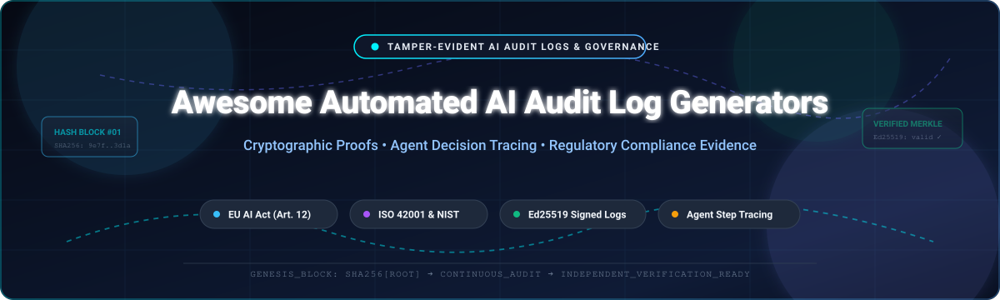

<p align="center">
  
</p>

<p align="center">
  <a href="https://github.com/ishandutta2007/Awesome-Awesome-Awesome"></a>
  <a href="https://discord.gg/jc4xtF58Ve"></a>
  <a href="https://github.com/ishandutta2007/Awesome-Automated-AI-Audit-Log-Generators/stargazers"></a>
  <a href="https://github.com/ishandutta2007/Awesome-Automated-AI-Audit-Log-Generators/network/members"></a>
  <a href="https://github.com/ishandutta2007/Awesome-Automated-AI-Audit-Log-Generators/issues"></a>
  <a href="https://github.com/ishandutta2007/Awesome-Automated-AI-Audit-Log-Generators/blob/main/LICENSE"></a>
  <a href="https://github.com/ishandutta2007/Awesome-Automated-AI-Audit-Log-Generators/pulls"></a>
  <a href="https://github.com/ishandutta2007"></a>
</p>

---

# 🛡️ Awesome Automated AI Audit Log Generators

> **A curated directory of SaaS platforms, enterprise tools, and open-source frameworks for Automated AI Audit Log Generation, Tamper-Evident Records, Agent Decision Tracing, and Regulatory Compliance Evidence (EU AI Act, ISO/IEC 42001, NIST AI RMF).**

*Last updated: March 2026*

---

## 🔍 Overview & SEO Highlights

Modern artificial intelligence deployments—spanning Large Language Models (LLMs), compound AI workflows, retrieval-augmented generation (RAG) pipelines, and autonomous AI agents—demand **verifiable, tamper-evident audit trails**. Regulatory frameworks such as **EU AI Act (Article 12)**, **ISO/IEC 42001:2023**, and **NIST AI RMF** mandate continuous logging, traceability of decisions, and cryptographic proofs that third-party auditors can validate independently.

This repository catalogs:
- 🏢 **Enterprise SaaS Platforms**: End-to-end AI governance, risk evaluation, and compliance platforms.
- 💻 **Open-Source Libraries & SDKs**: Self-hosted, hash-chained evidence stores, OpenTelemetry GenAI interceptors, and Merkle-proof audit ledgers.
- 📜 **Cryptographic Frameworks**: Ed25519-signed append-only ledgers, RFC 8785 canonical JSON formatting, and external witness anchors.

---

## 📑 Table of Contents

- [📊 Sector Overview & Market Dynamics](#-sector-overview--market-dynamics)
- [🏢 SaaS & Hosted Platforms](#-saas--hosted-platforms)
- [💻 Open-Source GitHub Projects](#-open-source-github-projects)
- [🏗️ Architectural Blueprint for Custom Audit Systems](#️-architectural-blueprint-for-custom-audit-systems)
- [⚖️ Regulatory Standards & Compliance Crosswalk](#️-regulatory-standards--compliance-crosswalk)
- [🔐 Core Cryptographic Verification Principles](#-core-cryptographic-verification-principles)
- [🤝 How to Contribute](#-how-to-contribute)
- [📈 Star History](#-star-history)
- [💖 Support & Community](#-support--community)
- [⚠️ Disclaimer](#️-disclaimer)

---

## 📊 Sector Overview & Market Dynamics

The global **AI Governance and Audit Logging market** is estimated at **$420M–$940M in 2025/2026** and is projected to expand rapidly to **$2.6B–$7.4B by 2030**, advancing at a Compound Annual Growth Rate (CAGR) between **36% and 51%**. This surging trajectory is fueled by strict regulatory compliance deadlines under the European Union AI Act (Article 12 requirements for automated logging in high-risk AI), ISO/IEC 42001 certifications, and increasing enterprise liability around autonomous agent operations.

The industry currently displays **moderate to high fragmentation**, characterized by a competitive mix of specialized startups (focusing on cryptographic evidence, guardrails, and agent tool-trace logging), broad enterprise Governance, Risk, and Compliance (GRC) incumbents (e.g., OneTrust, AuditBoard), and hyperscale cloud providers (IBM, Microsoft, AWS). While the market is not yet a winner-take-all landscape, consolidation is accelerating through aggressive strategic acquisitions—such as **F5 acquiring CalypsoAI for $180M** and **AuditBoard acquiring FairNow**—as enterprises prioritize unified platforms capable of bridging operational observability with audit-ready regulatory evidence.

---

## 🏢 SaaS & Hosted Platforms

The table below presents leading enterprise SaaS products for AI audit log generation, governance, and model monitoring, **sorted descending by company scale and valuation**:

| Platform / Product | Company Scale & Valuation | Starting Price | Free Tier / Trial Limits | Core Capabilities & Audit Focus |
| :--- | :--- | :--- | :--- | :--- |
| **[IBM watsonx.governance](https://www.ibm.com/products/watsonx-governance)** | **$210B+ Market Cap** (NYSE: IBM) / $62B+ Annual Revenue | **$3,500 / month** (~$42,000/year base tier on AWS/IBM Cloud; or $0.64/Resource Unit baseline) | **30-day free trial** with 200 Resource Units (RUs) and up to 5 concurrent evaluations (no perpetual free tier) | Enterprise-scale AI lifecycle governance, automated model factsheets, continuous risk/drift monitoring across multi-cloud models (OpenAI, AWS, Meta), and Guardium AI security integration. |
| **[OneTrust AI Governance](https://www.onetrust.com/)** | **$4.5B Valuation** (Series D) / $400M+ ARR | **$10,000 / year** (Foundational contract floor for AI discovery and governance module) | **14-day guided sandbox proof-of-concept (POC)** limited to 1 AI asset profile upon sales qualification (no perpetual free tier) | Centralized enterprise AI inventory, automated regulatory crosswalks (EU AI Act, ISO 42001), dynamic risk scoring, approval workflows, and auditor-ready evidence trail exports. |
| **[FairNow](https://fairnow.ai/)** | **$3.0B+ Valuation** (Acquired by AuditBoard / Hg Capital) / ~$200M+ Parent ARR | **$15,000 / year** (Dedicated AI compliance and questionnaire module add-on tier) | **14-day assisted pilot** limited to EU AI Act readiness assessment questionnaire & 1 system profile (no perpetual free tier) | Automated regulatory compliance tracking, vendor risk assessment questionnaires, algorithmic bias monitoring, and integration with AuditBoard GRC workflows. |
| **[Fiddler AI](https://www.fiddler.ai/)** | **~$300M Valuation** ($102M total funding; $30M Series C Jan 2026) / ~$15M ARR | **$0.002 / trace** (Developer entry tier from ~$500/month; Enterprise tier from $30,000/year) | **Free forever plan** with up to 10,000 requests/month for real-time safety guardrails; or **30-day AWS SageMaker trial** supporting up to 5 models | Real-time LLM observability, prompt injection & hallucination defense, model performance & drift detection, explainability, and verifiable trace logs for agentic systems. |
| **[CalypsoAI](https://calypsoai.com/)** | **$180M Valuation** (Acquired by F5 / NASDAQ: FFIV, $15B+ Market Cap) | **$24,000 / year** ($2,000/month entry enterprise deployment license via AWS Marketplace) | **14-day guided proof-of-concept (POC)** limited to 1 live model endpoint & 50,000 audited prompts (no perpetual free tier) | Inference-layer AI defense, real-time prompt injection & jailbreak blocking, model validation, and tamper-proof session audit logs for enterprise & government deployments. |
| **[Credo AI](https://www.credo.ai/)** | **~$100M Valuation** ($39M total funding) / ~$5M–$8M ARR | **$30,000 / year** (Base annual subscription tracking up to 5 AI models/use cases) | **30-day guided pilot evaluation** limited to 2 AI use-case evaluations upon enterprise demo qualification (no perpetual free tier) | Policy-as-code governance, prebuilt intake questionnaires, Responsible AI Standard crosswalking, risk-impact assessments, and auditable model cards. |
| **[Holistic AI](https://www.holisticai.com/)** | **~$85M Valuation** ($18M+ funding & grants) / ~$8M–$13M ARR | **$25,000 / year** (Starting annual license for risk assessment and governance modules) | **14-day assisted evaluation** covering 1 algorithmic audit report & 1 model safety assessment (no perpetual free tier) | Algorithmic auditing (bias, robustness, explainability, privacy), risk-scoring pipelines, and automated export-ready conformity reports tailored for regulators. |
| **[ModelOp](https://www.modelop.com/)** | **~$70M Valuation** ($16M funding, Series B) / ~$6M–$10M ARR | **$35,000 / year** (ModelOp Center starter license for up to 10 model inventories) | **30-day proof-of-value (POV)** sandbox limited to 2 model governance automation workflows (no perpetual free tier) | Full-lifecycle AI orchestrator (traditional ML, GenAI, and agentic AI), automated review and approval gates, regulatory policy enforcement, and audit systems of record. |
| **[Monitaur](https://monitaur.ai/)** | **~$40M Valuation** ($13.2M funding, Series A) / ~$3M–$5M ARR | **$18,000 / year** (Entry annual subscription tier covering assurance for up to 3 models) | **14-day sandbox trial** limited to 1 model audit environment upon consultation (no perpetual free tier) | ML assurance, algorithmic bias auditing, continuous model monitoring, and regulatory compliance audit records designed for insurance, healthcare, and financial services. |
| **[Trustible](https://trustible.ai/)** | **~$30M Valuation** ($7.7M seed funding) / ~$2M ARR | **$12,000 / year** (Entry platform tier for up to 5 AI use-case registries and evaluations) | **14-day interactive trial** limited to 2 use-case intake evaluations and compliance templates (no perpetual free tier) | Automated risk scoring, multi-framework compliance mapping (NIST AI RMF, EU AI Act, ISO 42001), AI asset registry, and audit-ready reporting. |

---

## 💻 Open-Source GitHub Projects

The following curated open-source projects provide verifiable audit trails, agent tool-call logging, OpenTelemetry tracing, and compliance reporting. **Sorted descending by GitHub star count**:

1. **[Langfuse](https://github.com/langfuse/langfuse)** [](https://github.com/langfuse/langfuse/stargazers)
   - *Open-source LLM engineering and observability platform.* Captures full nested traces, tool executions, cost metrics, and user feedback into immutable audit logs. Ideal for debugging, monitoring, and compliance reviews in complex LLM pipelines.
2. **[Promptfoo](https://github.com/promptfoo/promptfoo)** [](https://github.com/promptfoo/promptfoo/stargazers)
   - *CLI and library for LLM application evaluation, automated red-teaming, and security regression auditing.* Generates deterministic compliance test reports, vulnerability scans, and guardrail validations for production AI models.
3. **[DeepEval](https://github.com/confident-ai/deepeval)** [](https://github.com/confident-ai/deepeval/stargazers)
   - *Production-grade evaluation framework for LLM applications.* Features unit testing for hallucinations, bias, and answer relevancy, outputting structured audit records and compliance metrics across CI/CD pipelines.
4. **[Arize Phoenix](https://github.com/Arize-ai/phoenix)** [](https://github.com/Arize-ai/phoenix/stargazers)
   - *Open-source AI observability and evaluation platform built on OpenTelemetry and OpenInference.* Provides distributed tracing, agent step evaluation, and RAG audit visualizations with nested spans and latency breakdown.
5. **[Guardrails AI](https://github.com/guardrails-ai/guardrails)** [](https://github.com/guardrails-ai/guardrails/stargazers)
   - *Adding structured validation, security guardrails, and compliance enforcement to LLM outputs.* Validates against toxicity, PII leaks, and schema non-compliance while recording verifiable runtime validation audit logs.
6. **[OpenLLMetry (Traceloop)](https://github.com/traceloop/openllmetry)** [](https://github.com/traceloop/openllmetry/stargazers)
   - *OpenTelemetry-based auto-instrumentation for AI agents and LLMs (Apache-2.0).* Emits standard `gen_ai` audit spans compatible with any OpenTelemetry collector, enabling portable, tamper-evident trace persistence.
7. **[Giskard](https://github.com/Giskard-AI/giskard-oss)** [](https://github.com/Giskard-AI/giskard-oss/stargazers)
   - *Testing and auditing framework for ML models and LLMs.* Detects performance vulnerabilities, hallucinations, and biases; automatically generates comprehensive audit reports for EU AI Act compliance.
8. **[TruLens](https://github.com/truera/trulens)** [](https://github.com/truera/trulens/stargazers)
   - *Evaluation and instrumented tracking tool for LLM and agentic applications.* Provides feedback functions, structured audit trails, and programmatic verification of RAG triads (context relevance, groundedness, answer relevance).
9. **[whylogs](https://github.com/whylabs/whylogs)** [](https://github.com/whylabs/whylogs/stargazers)
   - *Open standard for statistical data and AI profiling.* Generates lightweight, mergeable log profiles to audit data drift, model inputs, and behavioral degradation without storing raw sensitive payloads.
10. **[OpenTelemetry GenAI Semantic Conventions](https://github.com/open-telemetry/semantic-conventions)** [](https://github.com/open-telemetry/semantic-conventions/stargazers)
    - *Vendor-neutral standard attribute specifications for model invocations, vector searches, and agent tool execution logs.* Forms the technical cornerstone for portable, standardized audit logging across AI infrastructure.
11. **[AI Verify (VerifyWise Foundation)](https://github.com/aiverify-foundation/aiverify)** [](https://github.com/aiverify-foundation/aiverify/stargazers)
    - *AI governance testing framework and software toolkit by the AI Verify Foundation.* Evaluates AI systems against international governance frameworks (EU AI Act, ISO 42001) with test suites for fairness, explainability, and robustness.
12. **[Vaara](https://github.com/vaaraio/vaara)** [](https://github.com/vaaraio/vaara/stargazers)
    - *Governance and verifiable evidence layer for autonomous AI agents (AGPL-3.0).* Checks actions against defined policy, produces hash-chained tamper-evident audit trails, and enables offline verification using public keys. Includes adapters for LangChain, CrewAI, and OpenAI Agents SDK.
13. **[GuardClaw](https://github.com/TobyGE/GuardClaw)** [](https://github.com/TobyGE/GuardClaw/stargazers)
    - *Enterprise cryptographic execution evidence for AI agents.* Converts LLM tool calls and decisions into tamper-evident, Ed25519-signed, mathematically verifiable evidence. Features RFC 8785 canonicalization, causal hash DAGs, out-of-process signing daemons, and Merkle inclusion proofs.
14. **[AuditWeave](https://github.com/vimalnakrani08/auditweave)** [](https://github.com/vimalnakrani08/auditweave/stargazers)
    - *Tamper-evident, auditor-navigable evidence trails for AI-assisted workflows.* Records source documents, retrievals, transformations, inferences, and human approvals into a single SHA-256 hash-chained append-only ledger (stdlib only, zero runtime dependencies).
15. **[Arcaeon Audit](https://github.com/Arcaeon-io/arcaeon-audit)** [](https://github.com/Arcaeon-io/arcaeon-audit/stargazers)
    - *Tamper-evident, audit-ready logs for AI agents.* Wraps `arcaeon-ledger` with event vocabulary and regulator-ready export bundles for EU AI Act Article 12, with hash-chained records and external witness anchoring for truncation detection.
16. **[AIAuditLog](https://github.com/sekacorn/AIAuditLog)** [](https://github.com/sekacorn/AIAuditLog/stargazers)
    - *Versioned JSON event envelope and schema export for AI audit logging.* Features typed models for models, agents, tools, and benchmarks; RFC 8785 canonical JSON; SHA-256 digests; checkpoints with Ed25519 signatures; and deterministic redaction.
17. **[Merkle-Audit](https://github.com/maco144/merkle-audit)** [](https://github.com/maco144/merkle-audit/stargazers)
    - *Tamper-evident audit logging for AI agent tool calls.* Uses simplified Merkle Mountain Ranges (MMR) and SQLite persistence to commit every action to an append-only hash chain, invalidating subsequent entries if historical records are modified.
18. **[SealVera](https://github.com/sealvera/sealvera-python)** [](https://github.com/sealvera/sealvera-python/stargazers)
    - *Python SDK for tamper-evident audit trails for AI agents.* Two-line integration providing cryptographically sealed, immutable decision logs capturing prompts, outputs, reasoning, confidence scores, and drift detection with zero hard dependencies.
19. **[Aegis Workbench](https://github.com/sanjaynandanj/aegis)** [](https://github.com/sanjaynandanj/aegis/stargazers)
    - *Enterprise AI governance workbench for EU AI Act and NIST AI RMF (Apache-2.0).* Evaluates policy-as-code, auto-generates model cards and Annex IV technical documentation, and writes state changes to an Ed25519-signed append-only ledger.

---

## 🏗️ Architectural Blueprint for Custom Audit Systems

To construct an enterprise-grade, self-hosted AI audit log platform, combine best-of-breed open-source modules across the stack:

```
┌──────────────────────────────────────────────────────────────┐
│                    Autonomous AI Agent                       │
│           (LangChain / CrewAI / OpenAI Assistants)           │
└──────────────────────────────┬───────────────────────────────┘
                               │
                               ▼
┌──────────────────────────────────────────────────────────────┐
│            Interception & Semantic Standardization           │
│   • OpenLLMetry / OpenTelemetry GenAI Semantic Conventions   │
│   • Guardrails AI (Output validation & schema enforcement)   │
└──────────────────────────────┬───────────────────────────────┘
                               │
                               ▼
┌──────────────────────────────────────────────────────────────┐
│            Cryptographic Integrity & Evidence Layer          │
│   • GuardClaw / SealVera (Ed25519 signatures, RFC 8785)      │
│   • AuditWeave / Merkle-Audit (SHA-256 Hash Chaining / MMR)  │
└──────────────────────────────┬───────────────────────────────┘
                               │
                               ▼
┌──────────────────────────────────────────────────────────────┐
│             Policy Enforcement & Decision Gate               │
│   • Vaara (Risk scoring: Allow / Block / Escalate)           │
│   • DeepEval / Promptfoo (Automated test evaluation)         │
└──────────────────────────────┬───────────────────────────────┘
                               │
                               ▼
┌──────────────────────────────────────────────────────────────┐
│             Storage, Indexing & Audit Dossiers               │
│   • ClickHouse / PostgreSQL (High-throughput log indexing)   │
│   • AI Verify / Aegis (EU AI Act & ISO 42001 export dossiers)│
└──────────────────────────────────────────────────────────────┘
```

---

## ⚖️ Regulatory Standards & Compliance Crosswalk

| Regulation / Standard | Primary Mandate | Technical Logging Requirement | Supported Solutions |
| :--- | :--- | :--- | :--- |
| **EU AI Act (Article 12)** | Automatic recording of events ("logs") over high-risk AI system lifecycles. | Continuous logging of operations, input/output data traces, operator IDs, and anomaly events with integrity protections. | IBM watsonx, OneTrust, Aegis Workbench, Vaara, Arcaeon Audit |
| **ISO/IEC 42001:2023** | Artificial Intelligence Management System (AIMS) governance and traceability. | Traceable AI risk management records, model inventory documentation, and verification of policy compliance. | Credo AI, Holistic AI, Trustible, VerifyWise |
| **NIST AI RMF 1.0** | Govern, Map, Measure, and Manage functions for trustworthy AI. | Transparent metrics for model drift, bias evaluation, robustness tests, and human oversight decision trees. | ModelOp, FairNow, Fiddler AI, Giskard, TruLens |
| **SOC 2 & HIPAA** | Tamper-evident operational access and data processing audit trails. | Cryptographic verification, non-repudiation of agent tool actions, and PII redaction envelopes. | GuardClaw, SealVera, AIAuditLog, AuditWeave |

---

## 🔐 Core Cryptographic Verification Principles

When designing or evaluating AI audit log generators, keep the following technical truths in mind:

- ❌ **Plain log files fail the compliance bar**: Standard flat files or unauthenticated database rows can be modified, deleted, or reordered by anyone with root/admin access without leaving an evidentiary trail.
- 🔗 **Hash chaining proves sequence and non-tampering**: In an append-only hash chain, each block incorporates the SHA-256 digest of its predecessor. Any backdated alteration invalidates all subsequent hashes.
- 🔏 **Digital signatures authenticate author and checkpoint**: Ed25519 cryptographic signatures bind checkpoints to verified public keys, establishing that the log was authored by the authorized system daemon.
- ⚓ **External witness pinning prevents truncation**: Hash chaining alone cannot prevent an attacker from truncating the end of a log. Periodically publishing head digests to an external witness or public ledger provides truncation detection.

---

## 🤝 How to Contribute

We welcome contributions from compliance officers, security researchers, and AI engineers! 🌟

1. Fork this repository.
2. Add your SaaS product or open-source project to `README.md` following the existing format.
   - For SaaS: include pricing, free tier/trial limits, company size, and core audit features.
   - For Open-Source: add repository link, social star badge, and description.
3. Submit a Pull Request with a clear explanation of the platform's verifiable audit capabilities.

For curated lists across other domains, explore the [Awesome Collection](https://github.com/ishandutta2007/Awesome-Awesome-Awesome).

---

## 📈 Star History

[](https://star-history.dera.page/#ishandutta2007/Awesome-Automated-AI-Audit-Log-Generators&type=date&legend=top-left)

---

## 💖 Support & Community

Thank you for exploring and utilizing the **Awesome Automated AI Audit Log Generators** repository! 🛡️

If you find this curated collection helpful for your AI governance, compliance, or engineering audits:
- ⭐ **Star this repository** to help others discover it!
- 🍴 **Fork it** to adapt it to your organization's internal compliance standards.
- 📢 **Share it** with fellow AI engineers, compliance officers, and security teams.
- ☕ **Sponsor / Buy a coffee**: Support ongoing curation, open-source verification research, and directory maintenance via the [GitHub Sponsor Dashboard](https://github.com/sponsors/ishandutta2007).

---

## ⚠️ Disclaimer

- This repository is a **community-curated index** and does not constitute formal legal, regulatory, or compliance advice.
- Implementing an automated audit log generator does not inherently guarantee regulatory compliance with the EU AI Act, GDPR, or HIPAA; comprehensive policies, organizational governance, and cryptographic key custody remain the deploying organization's responsibility.
- Product pricing, enterprise tier terms, and trial policies are subject to change by respective vendors.

---

<p align="center">
  <b>Built for compliance officers, security engineers, and developers constructing transparent, verifiable AI infrastructure.</b><br/>
  <sub>Maintained with ❤️ by <a href="https://github.com/ishandutta2007">Ishan Dutta</a> and community contributors.</sub>
</p>
